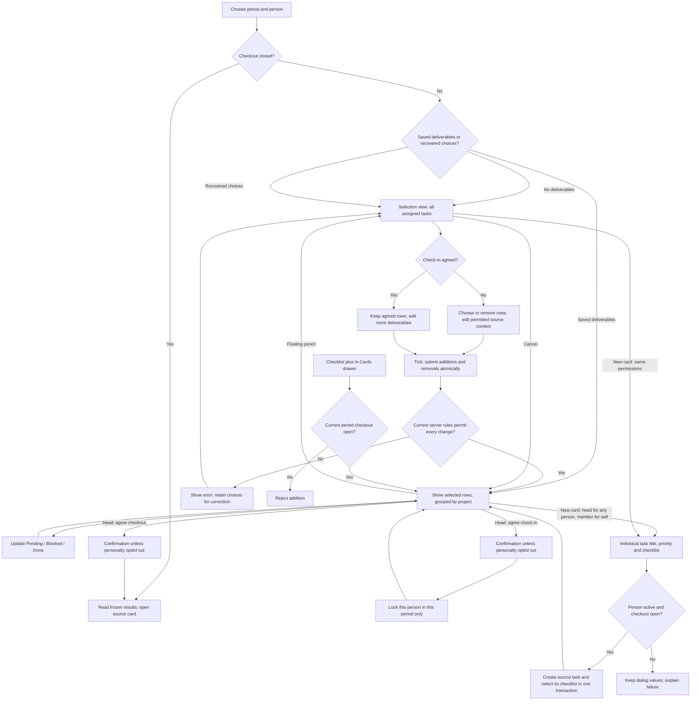

# Check-in workspace and professional records

Cards are edited individually in their drawer. Board and table selection checkboxes, the bulk-action toolbar and its write/undo API routes have been removed. Checklist completion and check-in deliverable selection remain separate workflows.

Check-in selection lists only active, undeleted source tasks; completed or deleted tasks already recorded remain in the saved check-in history. Personnel saves require a photo and an explicit military-rank entry, and validation targets the exact field and original row. Import preserves parenthesized previous occupations for retired relatives. Collapsed navigation labels do not occupy icon layout space.

## Check-in flow

The same backend rules apply to the page, card drawer, assistant and direct API calls. The UI never grants permissions beyond the actor's ordinary task permissions. Agreement is per person and period. The Nov 2 unlock was a previous one-time migration; this release does not repeat it.

| Operation                            | Unagreed                                           | Check-in agreed             | Checkout closed                                  |
| ------------------------------------ | -------------------------------------------------- | --------------------------- | ------------------------------------------------ |
| Choose deliverables                  | Add/remove                                         | Add only                    | No                                               |
| Change period progress               | Yes                                                | Yes                         | No                                               |
| Change agreed checklist wording      | Only if no other retained agreement protects it    | No                          | No                                               |
| Rename source task / change priority | Ordinary source permissions                        | Ordinary source permissions | Source card only; historical results stay frozen |
| Add new source checklist items       | Yes                                                | Yes                         | Source card only                                 |
| Delete referenced task/checklist     | Never while any retained check-in reference exists | Never                       | Never                                            |
| Reorder period cards                 | Yes                                                | Yes                         | No                                               |

Priority order is urgent, high, medium, low, then no priority. Moving a group switches that person's period layout to manual. Project headings occur once; task headings retain their own priority. Blocked rows count toward total, never done. Selection is saved as an atomic delta; stale versions or newly locked content are rejected without partial writes. Unsaved choices survive navigation in the same browser session. Title/checklist edits use explicit edit controls and Enter/Escape.

The timer is at the right of the person header, left of the existing controls. It uses a deadline to stay accurate in background tabs. It offers start/resume, pause, stop/reset, optional sound, and 20/10-second/completion effects. Reduced motion is respected.

## Records and downloads

Résumé and Personnel record are separate entries in the Profile settings sidebar. Draft typing is saved locally under the account and department; publishing/sharing requires Save. Optimistic revisions prevent overwriting a newer saved record. Device storage failures are shown.

Personnel records are available only to the owner and the department head, with database RLS and API authorization. They are not included in the public directory or the assistant's automatically collected context. The annotated Эшматов Word sample supplied on November 4 is the document authority, superseding the earlier HTML wherever they differ. The user's latest instruction makes employment dates year-only, including the current-post introduction; existing month/day data remains stored for compatibility but is neither displayed nor required. The editor uses two document pages with inline fields and examples; Preview shows the completed document, and clicking a value returns to editing. Latin/Cyrillic downloads use AI to identify names to preserve and show an editable document review without modifying saved data. Automatic transliteration cannot resolve every linguistic ambiguity; the review is deliberate.

People uses cards only. Search is followed by a multiselect unit dropdown. The head sees a small download row under education: résumé Word export and personnel record with Latin/Cyrillic downloads. The résumé contains the complete saved public professional profile, including all descriptions, education, experience, skills, languages, hobbies, certifications and links. Word paginates longer profiles naturally without truncation, fixed page limits or a footer referring to People. No private family information enters a résumé.

Profile photo controls include crop, pan, zoom, rotate, mirror and reset. The avatar is square and the personnel portrait is 3:4. People photos open in a separate lightbox; Escape closes the topmost overlay first.

Import sits between Save and Preview. PDF with extractable text, DOCX, ODT, RTF, text, Markdown and HTML are scanned and parsed before reaching the configured department AI provider. Each populated field must be supported by a quote in the extracted document; missing or ambiguous facts remain blank. Scanned-only PDFs and incomplete extraction are rejected. Import changes the recoverable local draft, with Undo, warnings and review; only Save publishes the private record. Review remains required because automated parsing cannot guarantee linguistic correctness.

Import correction recognizes Uzbek date suffixes and table-cell quotations. Missing study mode or employment status remains unset. After a corrective AI reply, any still-unsupported fields are blanked and linked for review while verified content is retained; a malformed correction cannot discard an earlier usable extraction. A wholly unverified answer has its own message rather than a provider-outage message. No document content is written to diagnostic logs.

The preview and Word export use the approved sample's A4 geometry, Times New Roman 11-point body, 14-point main headings, 12-point family heading, 8-point label spacing, 1486-twip employment tab stop aligning the first and wrapped workplace lines, and 10527-twip family table (columns 1260/2160/1980/2860/2267). The languages/military-rank pair is retained, deceased relatives' work/address cells merge, and explanatory notes, annotation bubbles, footers and page numbers are excluded. Study mode begins unselected; a master's qualification can stand alone as in the sample. Preview scales uniformly on narrow screens. Résumé and personnel downloads show their names above separate saved revision dates; unknown historical dates are omitted instead of fabricated. The compact row follows the user-selected screenshot: one shared download icon on the left, names above parenthesized dates, and the personnel menu chevron at the right. Completed jobs retain both endpoints even in the same year (2026–2026); only an ongoing job uses the current-position abbreviation. Personnel dates are restricted to the real department head. The head's Latin/Cyrillic menu opens the same AI-assisted export review used by the owner. Trackpad and two-finger touch gestures zoom the crop without zooming the browser. Rotate, flip and reset are the three controls below it.

Personnel import additionally preserves a cell-by-cell reading of tables. A uniquely matched relative in a labelled source table can recover a complete address, birthplace and job without borrowing another person's row. Ambiguous duplicate names are not matched. Matching birth-year prefixes are removed from birthplace display/export, including existing saved records, so the year appears once. Original records are not silently rewritten; the user reviews and saves a re-import to recover previously omitted values.

## Task lifecycle and loading

Home task tabs are To do, In progress, Done and Deleted. Deleted records are visible as historical rows and do not reappear in upcoming deadlines. Existing archived tasks migrate to Done, retaining their records, references and historical timestamps. A database constraint rejects new archived task states. Project and department lifecycle controls remain separate from task status.

Card menus contain Pin, Create group, Mark done and Delete. Pinning has no five-card cap or feature-switch dependency. Personal pins remain personal; the head can also pin a task for its assignee. Both personal and assignee pins appear first in automatic and manual board order, preserving the selected order within each partition. Referenced source deletion is disabled with a hover/focus explanation and rejected server-side. The drawer exposes common actions directly. Arrow keys move the board without first focusing its scrollbar and yield to text fields, menus and dialogs. Dragging changes ordering to Manual automatically.

The By person tab opens the current user's work unless a board column header or the person chooser selects a colleague. It reuses the searchable Check-in/out chooser with photos and unit colors. It follows every cursor for active and deleted records, then presents To do, In progress, Done and Deleted. Checklists start collapsed; live titles open the shared right drawer. Deleted rows offer a permanent Restore action, independent of the existing 30-second deletion Undo. Restore requires ordinary task authority and a live parent project. For a deleted parent, an explicit confirmation lets its owner/head restore the project and cards deleted with it, then restores the specifically requested card. Other separately deleted cards stay deleted. Members without project authority receive owner/head guidance. The home Deleted list offers the same action. Members can create individual tasks only for themselves, including from Check-in; the head can assign them to another member.

Project tasks have task headings and indented, initially expanded checklists. Checklist rows share one action menu and one item-specific discussion across Projects, Cards, By person and Check-in. Discussion text does not modify a frozen agreement. Older task-level comments remain accessible separately. A locked source retains disabled edit/delete controls with reasons; the API enforces the same restrictions. Completed checklist items do not appear as selection candidates, while existing saved results remain in history. Structure tree and organisation-chart views now have separate skeletons; By person has its own four-column skeleton.

Route-chunk, session, permission and data loaders share view-specific skeleton layouts. Settings retain their navigation; personnel records show two document pages; People shows unit groups and profile cards; Check-in shows selectors, a person header, a right-side timer and task/checklist rows. Event detail, comments and attendees have their own layouts. Slow-network browser checks capture these states. Telegram setup lists active colleagues who have not connected, alongside the connected/total count.

## Calendar and assistant

Personal appointment attendees see the shared appointment and notes in their own calendar. Only the organizer edits/cancels it. Invitations, changes and removals generate deduplicated notifications. Private appointments without attendees remain private, including from the head.

Assistant actions use the ordinary domain routes and confirmation flow. The catalog includes check-in selection/layout/direct individual-task creation, public/private profile updates, calendar attendees, task/project/checklist operations, pinning, dependencies, reminders, time logs, templates and personal timers. The product-owned UI guide describes the actual navigation and controls separately from untrusted document content. Telegram group messaging is head-only, verifies group membership for mentions, and claims an operation receipt before sending. An ambiguous delivery is not automatically resent.

## One-time release operations

Migrations 2022–2027 add database protections, conservatively restore recoverable referenced sources, correct provable accidental archives, clear only the old free-text position/education values, and add private records/calendar invitations/group-message receipts. Migration 2029 now moves every remaining archived task to Done and preserves it, as explicitly requested. Physically deleted records cannot be reconstructed without source data. Migration 2028 records independent résumé update dates and backfills only known profile-save audit timestamps.

The authorized education/position announcement was sent once with receipt `4826b8b2-8de7-4548-b4c0-d8e06ec99228`. Do not resend on retries, subsequent releases or application restarts.

### Birthday release (deployed and announced on 2026-11-05)

Migration 2031 adds optional, owner-written account date of birth, annual greeting/celebration receipts and department reminder deliveries. The initial release excluded DOB from People. The explicitly requested November 5 follow-up (migration 2032) exposes the saved account DOB to active department colleagues through a membership-checked directory projection, displayed above email in People. Writes remain owner-only; ordinary heads cannot read the private birthday or greeting stores directly. Separate scheduler RLS policies permit only active members of the current department; the DOB scheduler policy is read-only. The migration verifier records these explicit exceptions without changing other private tables or allowing other sensitive fields.

At 09:00 Asia/Tashkent, the worker sends the current linked department head a reminder for tomorrow and an English greeting draft. One owner/head/department/year receipt prevents duplicate sends, including simultaneous workers and app restarts. Eligibility, membership, DOB and Telegram linkage are rechecked after AI generation. Preparation leases recover after two minutes; explicit unsent rate limits retry after five minutes, at most five attempts. An ambiguous send is marked uncertain and never replayed automatically. A delayed worker catches up during the same day; it does not send yesterday's reminders. February 29 birthdays use February 28 in non-leap years. The optional input has a short birthday-wishes hint.

The head's draft and portal use the same stored annual AI letter. The department's configured, budgeted AI path receives bounded published role, skills, hobbies, fields and current role labels and only three server-derived private family booleans (known living children, parents, family). It never receives names, contacts, DOB, age, relative counts, institutions, employers, biography, private drafts or the raw personnel record. The prompt gently echoes interests while excluding specific family assertions and invented accomplishments. Invalid or unavailable AI falls back gracefully. A fallback can retry after five minutes until first portal presentation; a recovered AI letter may therefore improve an earlier outage-time Telegram fallback. AI letters and already-presented letters remain immutable that year.

Only a visible portal entry claims the two-minute celebration lease. Acknowledgement retries transient failures and persists once per user/year across devices. Returning to the foreground retries eligibility. DOB, active user and membership are revalidated after generation before presentation. The handwritten letter uses licensed open-stroke glyph paths, with the quill tip following each actual path and lifting between strokes. The compact closing combines that signature with an original textured wax seal; a walnut/brass stamp descends, presses, reveals the impression and lifts with a changing contact shadow after the final stroke. Quiet text controls sit below a light rule. All assets are local; handwriting pauses in hidden tabs. Read now, Escape, backdrop close, focus handling and reduced-motion support remain available. Original artwork prompts, font source and OFL attribution are in `apps/web/src/features/birthdays/assets/NOTICE.txt`.

Release `cb5ef6dec3255f588546b0227ac74bff71ac6d81` was deployed and verified on 2026-11-05. The actual department head reviewed and confirmed this exact one-time message through the ordinary Assistant action and canonical `POST /api/v1/telegram/group-message` route, with `mentionAll: false`: “Please add your date of birth in Account → Profile. It helps us celebrate your birthday and reminds the department head one day beforehand. Your date of birth is not shown in People.” The resulting operation receipt is `bbef7ee5-2b38-4ebb-b202-75fa38e9ca83`, sent at `2026-11-05T11:53:01.665633Z` (16:53 Asia/Tashkent). Receipt/audit verification confirmed the expected head, department and connected group, exact body hash, and exactly one matching sent receipt. The initially planned operation ID `8d1c2ab0-552d-46f0-9cb4-10761f652031` was never used and is superseded: **do not send it, run the prepared birthday-announcement browser runner, or repeat this announcement on future releases/startups**. Evidence: `artifacts/review/2026-11-05/birthday-announcement-receipt.json` and `production-release-verification.json`.

Personalized video QA uses a dedicated credential-free MockProvider entry point; it exercises real account/profile publication, configured AI permissions/budget/metering, cache, celebration receipt and UI, with no external provider call or Telegram delivery. Run from `apps/web` with `FLOW_API_PORT=48931`, `FLOW_WEB_PORT=48932`, `FLOW_DB_NAME=devon_flow_e2e_birthday_review`: `node node_modules/@playwright/test/cli.js test --config test/e2e/playwright.birthdays.config.ts --workers=1 --project=chromium`. Artifacts are under `artifacts/review/2026-11-05/`, including the complete `birthday-celebration.webm`, desktop writing/completed views and the reduced-motion mobile view. The ordinary birthday flow config separately covers a missing-provider fallback.

The birthday letter now includes an original, softly mastered 24-second music-box performance of Happy Birthday, synthesized locally without a third-party recording. Music plays once if the browser permits; otherwise the visible music control starts it after an explicit gesture. Native playback state drives that control. Mute is remembered in this browser; changing tabs or closing fades and pauses the player, and replaying handwriting does not force music back on. Audio, source score/render recipe and provenance are included in the asset pack. Only same-origin media autoplay is permitted by the server policy; browser gesture rules still apply. Standalone WAV/MP3 demos accompany the visual recording, whose Playwright source video does not capture system audio.

## Validation

The sidebar resize follow-up removes the 1,280px shell cap from collection workspaces (Cards and
its views, People, projects, structure, events, Personal and check-in/out). Profile/detail screens
retain their centered reading width. Expanded navigation reveals a stable-width label layout;
icons remain anchored at the rail center and row movement animates position without scaling text.
Browser checks sample expansion/collapse frames across ten routes at 1920px, Cards at 1024/1440px,
settings, held Ctrl+B and reduced motion. They verify all 200 reclaimed pixels, no horizontal page
overflow, centered icons and existing keyboard/tooltip behavior.

November 4 Mini App outage: the production web image omitted `apps/miniapp/dist`, and the shared
proxy policy blocked Telegram's SDK and framing. The image now builds and serves the separate
`/miniapp/` shell, with noncached HTML, immutable assets and real 404s for missing bundles. Only the
Mini App permits Telegram's official SDK and Telegram Web embedding. Public deployments can use
`CADDY_TLS_POLICY=public` for automatically renewed, publicly trusted IP/domain certificates.
Deployment checks exercise the built image and refuse a release whose Mini App route falls back
to the web SPA. Local validation covers the real SDK, a synthetic launch/session exchange, scoped
proxy headers and all 25 deployment/rollback cases. Renovate credentials are not runtime inputs.

Local verification includes 1,132 database migration checks; check-in, calendar, private-record and Telegram authorization integration tests; 52 AI context/action integration tests; browser flows for grouped selections, timers, drawers, draft recovery, photo cropping/lightboxes, head downloads, unit filtering and attendee calendars; desktop/mobile accessibility checks; and rendered Latin/Cyrillic personnel documents plus one-/two-page résumé samples. The November 4 revision additionally verifies source-supported personnel import, independent document dates and privacy, Telegram unconnected names, unlimited pinning, archived-task preservation, direct check-in creation, trackpad/touch crop gestures, keyboard board scrolling, and real slow-network loading states. Release CI and production readiness remain mandatory.

Terminology and crop references: [official higher education services](https://my.gov.uz/en/life-situations/069371c8-defc-41bf-ac89-eb01013bd7d1), [Uzbek academic degree regulation](https://lex.uz/uz/docs/3213407?otherlang=4), [official position terminology](https://nqaae.uz/en/structure/rahimboyev-sardor-qahramonovich), and [Telegram photo editor](https://translated.telegram.org/blog/photo-editor-and-passcodes).
