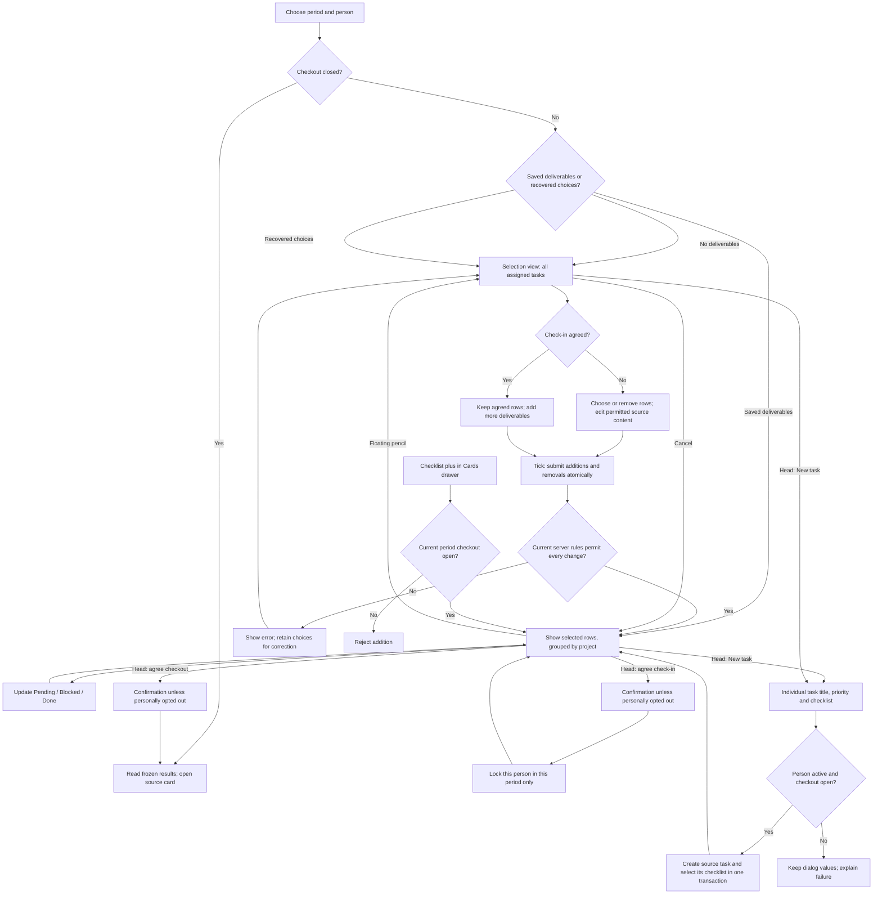

# Check-in workspace and professional records

## Check-in flow

The same backend rules apply to the page, card drawer, assistant and direct API calls. The UI never grants permissions beyond the actor's ordinary task permissions. Agreement is per person and period. The Nov 2 unlock was a previous one-time migration; this release does not repeat it.

| Operation                            | Unagreed                                           | Check-in agreed             | Checkout closed                                  |
| ------------------------------------ | -------------------------------------------------- | --------------------------- | ------------------------------------------------ |
| Choose deliverables                  | Add/remove                                         | Add only                    | No                                               |
| Change period progress               | Yes                                                | Yes                         | No                                               |
| Change agreed checklist wording      | Only if no other retained agreement protects it    | No                          | No                                               |
| Rename source task / change priority | Ordinary source permissions                        | Ordinary source permissions | Source card only; historical results stay frozen |
| Add new source checklist items       | Yes                                                | Yes                         | Source card only                                 |
| Delete referenced task/checklist     | Never while any retained check-in reference exists | Never                       | Never                                            |
| Reorder period cards                 | Yes                                                | Yes                         | No                                               |

Priority order is urgent, high, medium, low, then no priority. Moving a group switches that person's period layout to manual. Project headings occur once; task headings retain their own priority. Blocked rows count toward total, never done. Selection is saved as an atomic delta; stale versions or newly locked content are rejected without partial writes. Unsaved choices survive navigation in the same browser session. Title/checklist edits use explicit edit controls and Enter/Escape.

The timer is at the right of the person header, left of the existing controls. It uses a deadline to stay accurate in background tabs. It offers start/resume, pause, stop/reset, optional sound, and 20/10-second/completion effects. Reduced motion is respected.

## Records and downloads

Résumé and Personnel record are separate entries in the Profile settings sidebar. Draft typing is saved locally under the account and department; publishing/sharing requires Save. Optimistic revisions prevent overwriting a newer saved record. Device storage failures are shown.

Personnel records are available only to the owner and the department head, with database RLS and API authorization. They are not included in the public directory or the assistant's automatically collected context. The original supplied form's validation and document rules are retained. The editor uses two document pages with inline fields and examples; Preview shows the completed document, and clicking a value returns to editing. Latin/Cyrillic downloads use AI to identify names to preserve and show an editable document review without modifying saved data. Automatic transliteration cannot resolve every linguistic ambiguity; the review is deliberate.

People uses cards only. Search is followed by a multiselect unit dropdown. The head sees a small download row under education: résumé Word export and personnel record with Latin/Cyrillic downloads. The résumé contains the complete saved public professional profile, including all descriptions, education, experience, skills, languages, hobbies, certifications and links. Word paginates longer profiles naturally without truncation, fixed page limits or a footer referring to People. No private family information enters a résumé.

Profile photo controls include crop, pan, zoom, rotate, mirror and reset. The avatar is square and the personnel portrait is 3:4. People photos open in a separate lightbox; Escape closes the topmost overlay first.

Import sits between Save and Preview. PDF with extractable text, DOCX, ODT, RTF, text, Markdown and HTML are scanned and parsed before reaching the configured department AI provider. Each populated field must be supported by a quote in the extracted document; missing or ambiguous facts remain blank. Scanned-only PDFs and incomplete extraction are rejected. Import changes the recoverable local draft, with Undo, warnings and review; only Save publishes the private record. Review remains required because automated parsing cannot guarantee linguistic correctness.

The preview uses the supplied HTML's A4 geometry, type sizes, table and photo dimensions, without decorative footers or page numbers. It scales uniformly on narrow screens. Résumé and personnel downloads show separate saved revision dates; unknown historical dates are omitted instead of fabricated. Personnel dates are restricted to the real department head. The head's Latin/Cyrillic menu opens the same AI-assisted export review used by the owner. Trackpad and two-finger touch gestures zoom the crop without zooming the browser. Rotate, flip and reset are the three controls below it.

## Task lifecycle and loading

Home task tabs are To do, In progress, Done and Deleted. Deleted records are visible as historical rows and do not reappear in upcoming deadlines. Existing archived tasks migrate to Done, retaining their records, references and historical timestamps. A database constraint rejects new archived task states. Project and department lifecycle controls remain separate from task status.

Card menus contain Pin, Create group, Mark done and Delete. Pinning has no five-card cap or feature-switch dependency, and remains personal. Referenced source deletion is disabled with a hover/focus explanation and rejected server-side. The drawer exposes common actions directly. Arrow keys move the board without first focusing its scrollbar and yield to text fields, menus and dialogs. Dragging changes ordering to Manual automatically.

Route-chunk, session, permission and data loaders share view-specific skeleton layouts. Settings retain their navigation; personnel records show two document pages; People shows unit groups and profile cards; Check-in shows selectors, a person header, a right-side timer and task/checklist rows. Event detail, comments and attendees have their own layouts. Slow-network browser checks capture these states. Telegram setup lists active colleagues who have not connected, alongside the connected/total count.

## Calendar and assistant

Personal appointment attendees see the shared appointment and notes in their own calendar. Only the organizer edits/cancels it. Invitations, changes and removals generate deduplicated notifications. Private appointments without attendees remain private, including from the head.

Assistant actions use the ordinary domain routes and confirmation flow. The catalog includes check-in selection/layout/direct individual-task creation, public/private profile updates, calendar attendees, task/project/checklist operations, pinning, dependencies, reminders, time logs, templates and personal timers. The product-owned UI guide describes the actual navigation and controls separately from untrusted document content. Telegram group messaging is head-only, verifies group membership for mentions, and claims an operation receipt before sending. An ambiguous delivery is not automatically resent.

## One-time release operations

Migrations 2022–2027 add database protections, conservatively restore recoverable referenced sources, correct provable accidental archives, clear only the old free-text position/education values, and add private records/calendar invitations/group-message receipts. Migration 2029 now moves every remaining archived task to Done and preserves it, as explicitly requested. Physically deleted records cannot be reconstructed without source data. Migration 2028 records independent résumé update dates and backfills only known profile-save audit timestamps.

The authorized education/position announcement was sent once with receipt `4826b8b2-8de7-4548-b4c0-d8e06ec99228`. Do not resend on retries, subsequent releases or application restarts.

## Validation

Local verification includes 1,132 database migration checks; check-in, calendar, private-record and Telegram authorization integration tests; 52 AI context/action integration tests; browser flows for grouped selections, timers, drawers, draft recovery, photo cropping/lightboxes, head downloads, unit filtering and attendee calendars; desktop/mobile accessibility checks; and rendered Latin/Cyrillic personnel documents plus one-/two-page résumé samples. The November 4 revision additionally verifies source-supported personnel import, independent document dates and privacy, Telegram unconnected names, unlimited pinning, archived-task preservation, direct check-in creation, trackpad/touch crop gestures, keyboard board scrolling, and real slow-network loading states. Release CI and production readiness remain mandatory.

Terminology and crop references: [official higher education services](https://my.gov.uz/en/life-situations/069371c8-defc-41bf-ac89-eb01013bd7d1), [Uzbek academic degree regulation](https://lex.uz/uz/docs/3213407?otherlang=4), [official position terminology](https://nqaae.uz/en/structure/rahimboyev-sardor-qahramonovich), and [Telegram photo editor](https://translated.telegram.org/blog/photo-editor-and-passcodes).
